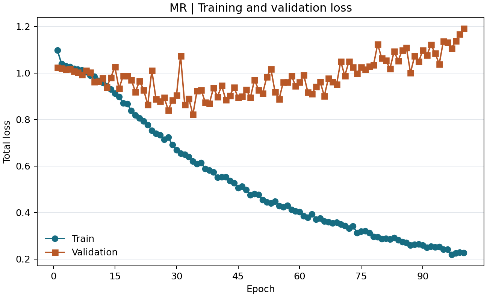
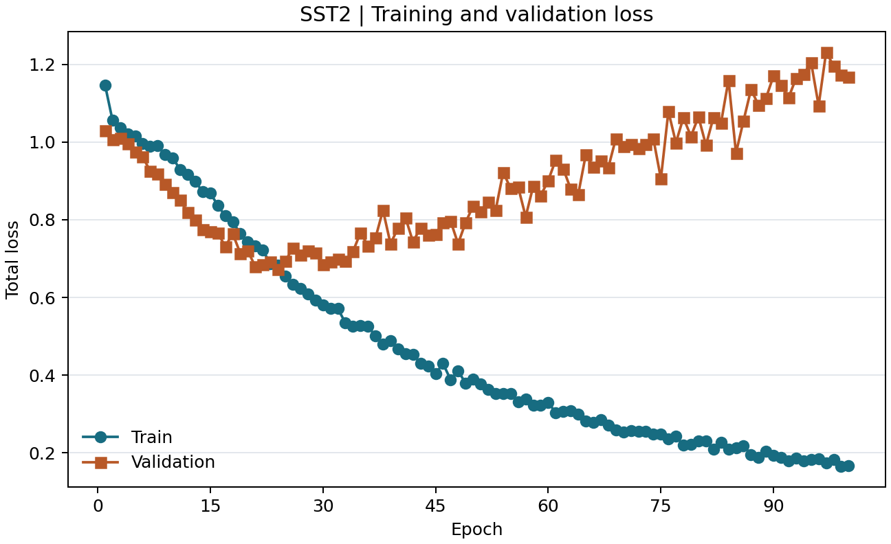

# Experimental Results

## 1. Reporting scope and evidence

This document reports the two runs selected for the current research report: MR from `runs_v3/mr` and SST-2 from `runs_last/sst2`. Complete copies are stored in `results/mr/` and `results/sst2/`.

The reported values come from the saved `config.json`, `history.csv`, `test_metrics.json`, and checkpoint tensors. A read-only consistency audit confirmed that each selected directory matches its source run byte for byte for all six included artifacts. Accuracy and Macro-F1 were recomputed from the saved confusion matrices, best epochs were checked against the histories, and parameter counts were obtained from saved tensor shapes. These checks are not a fresh inference evaluation or a retraining experiment.

Within a run, checkpoint selection uses validation accuracy and then validation loss. Across runs, the final experiments were selected by comparing test accuracy. The table below therefore reports exploratory results with test-informed run selection; it is not an unbiased, untouched final test evaluation. The amount of potential optimism is unknown.

## 2. Primary results

| Dataset | Source run | Test examples | Test accuracy | Macro-F1 | Best epoch |
| --- | --- | ---: | ---: | ---: | ---: |
| MR | `runs_v3/mr` | 1,066 | **76.17%** | **76.15%** | **95** |
| SST-2 | `runs_last/sst2` | 1,821 | **81.11%** | **81.10%** | **56** |

| Dataset | Correct / total | Best validation accuracy | Total validation loss at selected epoch |
| --- | ---: | ---: | ---: |
| MR | 812 / 1,066 | 75.80% | 1.135968 |
| SST-2 | 1,477 / 1,821 | 80.85% | 0.883926 |

The loss includes routed cross-entropy, auxiliary branch cross-entropy, and the Brier term. It should not be compared directly with a baseline's plain cross-entropy unless the objectives are matched.

Accuracy and Macro-F1 are close for both datasets. Their similar values are consistent with relatively balanced test labels and comparable class-wise F1 values. They do not establish cross-domain robustness or statistical superiority over another model.

## 3. Selected experimental settings

| Setting | MR | SST-2 |
| --- | --- | --- |
| Encoder | Scratch, randomly initialized | Scratch, randomly initialized |
| Feature dimension | 64 | 96 |
| Shared-encoder/TSSA heads | 1 | 2 |
| Vocabulary size | 17,089 | 13,846 |
| TSSA dimension / blocks | 48 / 2 | 48 / 2 |
| CNN kernels | 3, 5, 7 | 3, 5, 7 |
| Maximum sequence length | 64 | 64 |
| Epoch budget / batch size | 100 / 256 | 100 / 256 |
| Dropout / weight decay | 0.5 / 0.01 | 0.5 / 0.01 |
| Optimizer / learning rate | AdamW / 0.001 | AdamW / 0.001 |
| Threshold | 0.9 | 0.9 |
| Auxiliary / Brier weights | 0.4 / 0.1 | 0.4 / 0.1 |
| Seed / device / CPU threads | 42 / CPU / 8 | 42 / CPU / 8 |
| Recorded PyTorch version | 2.2.2 | 2.2.2 |

Both runs use the same general architecture, but the different feature dimensions and head counts mean that they are not identically sized models. The optional pretrained-encoder path was not used.

## 4. Confusion matrices and class-wise performance

True labels appear in rows and predicted labels in columns. Negative is class 0 and positive is class 1.

### 4.1 MR

| Actual / predicted | Negative | Positive | Total |
| --- | ---: | ---: | ---: |
| Negative | 389 | 144 | 533 |
| Positive | 110 | 423 | 533 |
| Total | 499 | 567 | 1,066 |

There are 812 correct classifications and 254 errors. Of the errors, 144 negative examples are predicted positive and 110 positive examples are predicted negative.

### 4.2 SST-2

| Actual / predicted | Negative | Positive | Total |
| --- | ---: | ---: | ---: |
| Negative | 753 | 159 | 912 |
| Positive | 185 | 724 | 909 |
| Total | 938 | 883 | 1,821 |

There are 1,477 correct classifications and 344 errors. Of the errors, 159 negative examples are predicted positive and 185 positive examples are predicted negative.

### 4.3 Derived class-wise metrics

The following values are calculated from the saved matrices; each class is treated as the positive class in turn.

| Dataset | Class | Precision | Recall | F1 |
| --- | --- | ---: | ---: | ---: |
| MR | Negative | 77.96% | 72.98% | 75.39% |
| MR | Positive | 74.60% | 79.36% | 76.91% |
| SST-2 | Negative | 80.28% | 82.57% | 81.41% |
| SST-2 | Positive | 81.99% | 79.65% | 80.80% |

These matrices describe error counts, not error causes. The saved aggregate records do not identify whether an error involves negation, sarcasm, implicit sentiment, or domain-specific wording. Those explanations require inspecting individual predictions and texts.

## 5. Adaptive route usage

| Dataset | Final route | Examples | Share of test set | Correct | Accuracy within route |
| --- | --- | ---: | ---: | ---: | ---: |
| MR | CNN | 797 | 74.77% | 665 | 83.44% |
| MR | TSSA | 87 | 8.16% | 46 | 52.87% |
| MR | CAA fusion | 182 | 17.07% | 101 | 55.49% |
| SST-2 | CNN | 1,330 | 73.04% | 1,162 | 87.37% |
| SST-2 | TSSA | 109 | 5.99% | 62 | 56.88% |
| SST-2 | CAA fusion | 382 | 20.98% | 253 | 66.23% |

For MR, `665 + 46 + 101 = 812` predictions are correct. For SST-2, `1,162 + 62 + 253 = 1,477` are correct. These sums agree with the overall confusion matrices.

| Dataset | Shared encoder and CNN executed | TSSA executed | CAA executed |
| --- | ---: | ---: | ---: |
| MR | 100.00% | 25.23% | 17.07% |
| SST-2 | 100.00% | 26.96% | 20.98% |

The final TSSA-route share excludes examples that execute TSSA and then proceed to CAA. Hence total TSSA execution is the sum of the final TSSA and fusion shares.

### Interpretation

Approximately three quarters of test examples exit through the CNN. This confirms that sparse routing bypasses later modules for many inputs. All examples have already passed through a shared Transformer encoder, so the exit percentages are not end-to-end runtime savings.

The CNN-selected subsets have higher observed accuracy than the TSSA- and fusion-selected subsets. The groups are selected by different confidence conditions, so this is not a fair same-example comparison of branch quality. In particular, low accuracy on the TSSA subset does not prove that adding TSSA hurts those examples, and high CNN-route accuracy does not establish the accuracy of a CNN-only model on the full test set.

Early-exit examples have CNN softmax confidence of at least 0.9, yet their observed accuracies are 83.44% for MR and 87.37% for SST-2. The positive gaps between the minimum confidence and observed accuracy are approximately 6.56 and 2.63 percentage points. This indicates overconfidence on the selected subsets; it is not a full expected-calibration-error calculation. The Brier training term and shared classification head have not eliminated this issue.

No per-example analysis establishes that the selected routes correspond to short, medium, or complex sentences. Such a claim requires relating route assignments to measured properties of each input.

## 6. Parameter counts

Counts below are derived from tensor shapes in the selected `best_model.pt` files. They include embeddings and all branches, regardless of how often a branch executes.

| Component | MR | SST-2 |
| --- | ---: | ---: |
| Shared encoder, including embeddings | 1,147,904 | 1,447,392 |
| TextCNN | 37,152 | 83,376 |
| Projection into TSSA | 3,120 | 4,656 |
| Two TSSA blocks | 47,042 | 47,044 |
| Projection out of TSSA | 3,136 | 4,704 |
| CAA fusion | 13,440 | 29,376 |
| Shared classification head | 514 | 770 |
| **Total** | **1,252,308** | **1,617,318** |

Word embeddings alone contain 1,093,696 parameters for MR (`17,089 * 64`) and 1,329,216 for SST-2 (`13,846 * 96`). They account for approximately 87.33% and 82.19% of the respective totals.

The SST-2 total of **1,617,318** applies specifically to the selected 96-dimensional, two-head checkpoint. Counts from a 64-dimensional SST-2 configuration are not interchangeable with this result.

Routing reduces conditional execution, not the stored parameter count. The compact total also reflects the scratch encoder, vocabulary size, and feature widths. Any parameter reduction relative to a pretrained BERT hybrid cannot be attributed solely to confidence routing. No parameter count of the original reference-paper implementations was measured in these experiments. Counts based on assumed reconstructions must be labeled as estimates and kept separate from measured checkpoint counts.

## 7. Training histories and generalization

| Dataset | Epoch | Training accuracy recorded during epoch | Validation accuracy | Training total loss | Validation total loss |
| --- | ---: | ---: | ---: | ---: | ---: |
| MR | 95 | 93.75% | 75.80% | 0.241788 | 1.135968 |
| MR | 100 | 94.17% | 75.52% | 0.226670 | 1.191756 |
| SST-2 | 56 | 90.81% | 80.85% | 0.331097 | 0.883926 |
| SST-2 | 100 | 95.86% | 79.13% | 0.167051 | 1.167981 |

Training metrics are accumulated while parameters change and dropout is enabled. Validation metrics are computed afterward with fixed parameters and dropout disabled, so the two sets are not evaluations under identical conditions.

The histories show substantial training-validation gaps. At epoch 100, MR training accuracy is about 94.17% while validation accuracy is 75.52%. For SST-2, training accuracy reaches 95.86% while validation accuracy is 79.13%. The SST-2 best validation checkpoint occurs at epoch 56, before the end of training; later training improves training fit without improving its best validation accuracy. These observations are consistent with overfitting.

Dropout 0.5, weight decay 0.01, and validation checkpoint selection are present. The records do not provide a controlled ablation establishing which intervention reduced overfitting, or by how much. Likewise, the saved history alone cannot prove that changing the head count or increasing epochs caused a particular gain.

### Saved loss curves

These figures plot the full training objective rather than only classification cross-entropy. Training and validation losses follow the distinct measurement conditions described above.

## 8. What the current evidence establishes

- The selected scratch models achieve the reported Accuracy and Macro-F1 on the supplied local splits.
- The stored models contain approximately 1.25 million parameters for MR and 1.62 million for SST-2.
- With threshold 0.9, 74.77% of MR and 73.04% of SST-2 test examples exit through the CNN.
- Sparse inference skips TSSA and CAA for early exits, but always executes the shared encoder and CNN.
- Selected checkpoints, configurations, vocabularies, metrics, histories, and curves are included in the repository.

The following claims have not been established by the available experiments:

- A specific speedup, latency reduction, throughput gain, or memory reduction relative to a reference model.
- Lower training time due to routing; training computes all branches.
- Better accuracy than CNN-only, TSSA-only, always-fused, or matched reference implementations on the same splits.
- Optimality of threshold 0.9 or the selected learning rate, batch size, or loss weights.
- Stability over random seeds, cross-validation folds, or data perturbations.
- Statistical significance, confidence intervals, or generalization to educational dialogue, multilingual text, or other domains.

Runtime, throughput, peak memory, training duration, and FLOPs were not recorded with these selected runs. Parameter counts and exit fractions cannot substitute for those measurements. Scores published for other datasets or evaluation protocols are contextual references, not directly comparable baseline results.

## 9. Additional experiments needed for stronger conclusions

The selected result table remains fixed as the report of the completed experiments. Additional analyses should be labeled separately rather than represented as if they already produced those numbers.

1. **Controlled execution comparison:** Benchmark adaptive and always-compute inference using the same saved weights, device, data, batching, warm-up, and timing protocol.
2. **Predictive ablations:** Evaluate branch predictions on the same examples, and train matched CNN-only, TSSA-only, and always-fused baselines to separate conditional computation from representation capacity.
3. **Threshold analysis:** Choose thresholds on validation data and report accuracy, Macro-F1, route coverage, and latency together.
4. **Uncertainty and robustness:** Repeat training with multiple seeds or an appropriate cross-validation design. Quantify uncertainty using the actual repeated evaluations; do not treat epochs as independent replicates.
5. **Calibration and error analysis:** Save per-example probabilities, routes, and labels; inspect confidence reliability, negation, sentence length, and difficult examples.
6. **Independent confirmation:** Use an evaluation set not consulted during run selection to assess the frozen configuration without repeating the current test-informed selection process.

## 10. Evidence files

| Evidence | MR | SST-2 |
| --- | --- | --- |
| Configuration | [config.json](results/mr/config.json) | [config.json](results/sst2/config.json) |
| Test metrics | [test_metrics.json](results/mr/test_metrics.json) | [test_metrics.json](results/sst2/test_metrics.json) |
| Epoch history | [history.csv](results/mr/history.csv) | [history.csv](results/sst2/history.csv) |
| Vocabulary | [vocab.json](results/mr/vocab.json) | [vocab.json](results/sst2/vocab.json) |
| Checkpoint | [best_model.pt](results/mr/best_model.pt) | [best_model.pt](results/sst2/best_model.pt) |

The current dependency constraints differ from the recorded PyTorch 2.2.2 environment. Exact Python and remaining historical package versions are not available in these files. See [methodology.md](methodology.md) for reproduction boundaries and [README.md](README.md) for commands.
